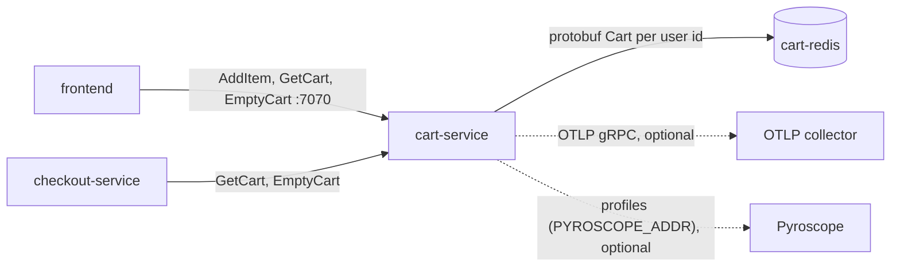
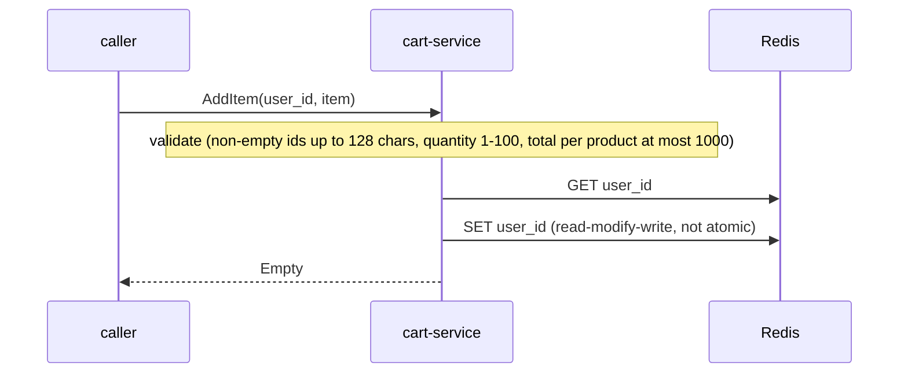

# Architecture

## Context

cart-service is stateless: all state is in Redis, one key per user (session) id with a protobuf-serialised `Cart` as the value. It calls no other service. The callers were checked in the `origin/main` code of the frontend (`cmd/server/rpc.go`) and checkout-service (`GetCart` and `EmptyCart`) on 2026-11-21.

## Request path

Both Redis round trips of one `AddItem` share the budget `REDIS_TIMEOUT_MS` (default 2000 ms); the caller's own deadline still wins when it is shorter. Storage errors are mapped to generic gRPC statuses without the Redis exception text (see [API](api.md)).

## Components

| File | Role |
|---|---|
| `src/Program.cs` | DI, Redis cache, gRPC with reflection, JSON console logs, OpenTelemetry, endpoints |
| `src/services/CartService.cs`, `CartValidation.cs` | the handlers and the input rules |
| `src/services/HealthCheckService.cs` | `grpc.health.v1`, `NOT_SERVING` while Redis does not answer a ping |
| `src/store/` | `ICartStore` and the `IDistributedCache`-backed `RedisCartStore`, the timeout option |
| `container/entrypoint.sh`, `src/ProfilingConfig.cs` | the image entrypoint that loads the Pyroscope .NET profiler only when `PYROSCOPE_ADDR` is valid, and the same rule as a C# function for the `starting` log line |
| `src/JsonLog*.cs`, `ServiceIdentity.cs`, `TelemetryConfig.cs`, `TelemetryExtensions.cs`, `RequestIdInterceptor.cs` | one JSON log shape, service identity, telemetry contract and export deadlines, request id into the logging scope |
| `src/HealthProbe.cs` | `cartservice healthcheck`: the container HEALTHCHECK (TCP connect, no shell needed) |
| `src/protos/cart.proto` | the service contract (package `hipstershop`) |

## Decisions

[ADR 1](adr/0001-redis-cart-without-ttl.md), [ADR 2](adr/0002-profiling-with-the-pyroscope-dotnet-profiler.md), [ADR 3](adr/0003-proto-package-stays-hipstershop.md).
